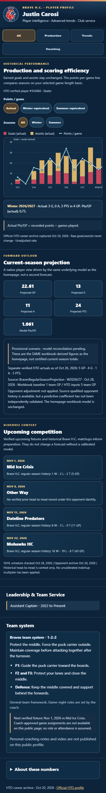
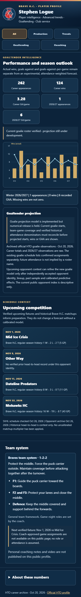

# HockeyOS Player Bio — Milestone-Quality Advanced Analysis Release Candidate

Date: October 28, 2026. Lead: BruTTech Engineering. Execution: BRUTTECH 1, isolated cloned feature branch.

## Product scope delivered

- Native polished embedded Bio header with authentic Brave H.C. logo, category buttons (All / Production / Trends / Goaltending / Coaching) and compact source-qualified panels.
- Historical chart: **actual** season G/A stacked bars and a distinct-scale points-per-game line. Three toggles: Actual, Winter equivalent, Summer equivalent. Raw totals and summer/winter record categories never change.
- Historical format configuration: all 18 HTO readable season labels explicitly matched the original Master Workbook season codes and the archived Summer/Winter formula. Source SHA is documented in the companion duration mapping evidence. Formula supports manager-specified period/game minutes as an analytical reference and declines unverified formats.
- Native individual skater projection powered by the exact existing shared `widgets/projection.json` model from the homepage. No iframe, homepage screenshot embed, recomputed forecast, or unverified statistical extrapolation. Five-game source versus one-game original model baseline is visibly provisional.
- New independent goalie projection model in JavaScript using historical attendance, expected remaining games, and increasing current-season weight. Seven synthetic tests pass. **Numerical current-season goalie forecasts remain held** pending season-specific team-game denominators, proven goalie results and future-role/source verification; no invented W, GAA, SHOs or save percentage.
- Goaltender actual historical wins/GAA chart and verified HTO goalie career statistics, labelled as recorded appearances rather than guaranteed starts.
- Upcoming opponent context from the source-qualified SVHL schedule and historic Brave H.C. matchups; unknown team histories explicitly do not become zero. The descriptive opponent index has no unvalidated predictive win-probability coefficient.
- Public general 1-2-2 team-system notes only. Private player-specific game coaching stays protected until coach/lineup/assignment approval and authenticated delivery.
- Explicitly defer homepage UI redesign and preserve original HTO native editor content.

## Browser QA

- 109 / 109 profiles render correctly at mobile widths; no JavaScript errors or document-level overflow.
- Legacy QA also checked 109 verified identities, leadership tenure parity and 320 / 390 / 625 / 1280-pixel screens.
- New premium browser QA exercises 109 player profiles and actual/winter/summer controls, goalie profile panel, source-valid opponent cards and coaching filter.
- 17 normalization contract tests PASS; 7 source-gated goalie model tests PASS. Candidate JavaScript syntax checks PASS.
- Screenshots from actual isolated Edge browser test:  and .

## Source and publication gates

Current HTO five-game season snapshot and HTO career archive are distinct dated source captures. Original Master Workbook SHA256 `0002fd9f06596af8d0a00fc1b53a618ef15479f941ad5c1e6265b27002a65154` was read-only verified and unchanged. No official Records, Awards, Statistics, homepage projection, weekly polls, confirmed goalie assignments, or private coaching input was modified.

Still open: independent release review and PR CI; source-governed goalie projection adapter with current HTO game and historical team denominator parity; independent calibrated opponent effects for skater model extension and new goalie model; authenticated coach-only game coaching.

**Release state:** feature branch candidate for review, not merged, not deployed, not a claim that provisional model is current. Do not automatically merge or publish before explicit approval.
